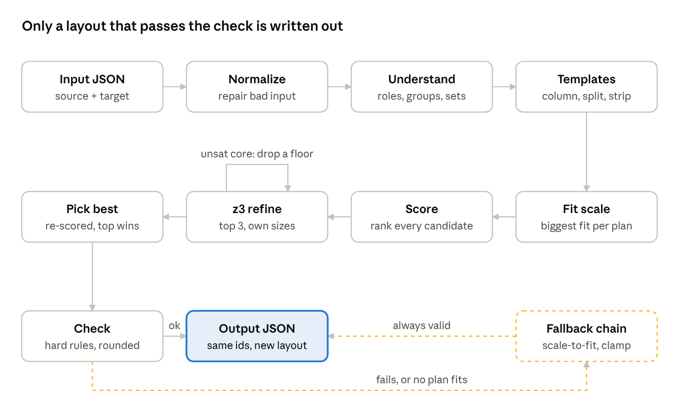

# CHAMELEON — layout reflow engine

`resize(source, target_canvas)` takes a design and a new canvas size and
returns the same design rearranged for the new shape. Nothing is added,
removed, redrawn or rewritten: the engine only moves and resizes the
elements it is given, and changes font sizes. It runs fully offline with no
model weights, so the outputs are deterministic.

## Approach

A naive resize stretches the picture. This engine treats the design like a
web page and lays it out again for the new canvas.

1. **Normalize.** Clean the input: fill in missing fields, clamp bad
   numbers, and read the canvas size (`engine/normalize.py`).
2. **Understand.** Work out what each element is: background, hero image,
   headline, body, CTA, logo or decoration. Group elements that belong
   together into units, using the designer's groups first, then text sitting
   on a badge or button, then multi-line texts that read as one phrase, and
   repeated sets such as icon rows (`engine/understand.py`).
3. **Propose layouts.** Build candidate layouts from a few templates:
   - a stacked **column**;
   - a **split**, with the hero in one panel and the text in the other;
   - a single-row **strip** for very wide banners;
   - a **proportional** scale when the target has nearly the same shape.

   Templates are flexbox-like trees (Column, Row, Wrap, Rigid) in
   `engine/templates.py` and `engine/layout.py`.
4. **Fit.** Measure text with the real fonts and find the largest scale at
   which everything fits (`engine/fit.py`, `engine/textmetrics.py`).
5. **Score.** Rank the candidates on:
   - readable text size;
   - no new overlaps;
   - type hierarchy kept from the source;
   - visual balance;
   - reading order;
   - how far each element drifted from its source position.

   This is in `engine/score.py`. Several readings of ambiguous roles are
   scored side by side (see `EVALUATION.md`).
6. **Refine.** Polish the top 3 candidates with the z3 constraint solver:
   align edges, even out gaps and push text sizes up while keeping
   everything on the canvas (`engine/solve.py`).
7. **Check and fall back.** Round values in the safe direction and run a
   strict check:
   - same ids;
   - every element on the canvas;
   - image aspect ratios kept;
   - text fits its box.

   If the reflowed layout fails, safer layers take over: uniform
   scale-to-fit, then clamped boxes, then pass-through. `resize()` never
   raises (`engine/resize.py`, `engine/check.py`, `engine/fallback.py`).



## How to run

### Docker (how scoring runs)

```bash
docker build --platform linux/amd64 -t chameleon-engine .
docker run --rm --network none \
  -v "$(pwd)/input:/app/input" \
  -v "$(pwd)/output:/app/output" \
  chameleon-engine
```

Every `*.json` task in `input/` (a source design plus a `target_canvas`)
produces `<task>_output.json` and `<task>_output.png` in `output/`.
Everything installs at build time, so the engine runs with `--network none`.

### Locally (Python 3.10+)

```bash
pip install -r requirements.txt
python -m engine.main
```

Set `CHAMELEON_DEBUG=1` to print which layer won for each task.

### Tests and evaluation

```bash
pip install -r requirements-dev.txt
pytest
python -m tools.run_eval --render
```

`tools.run_eval` runs the engine over the generated tasks and writes a
report and contact sheet to `build/eval/`.

## Repo layout

```
engine/       the engine (entry point: engine/resize.py)
tools/        evaluation, baselines, dataset conversion, judging sets
tests/        unit and property tests
renderer/     vendored transformer-convertor + cr-renderer
brand_kit/    assets and fonts used for rendering
input/        sample tasks
```

See `RULES.md` and `FAQ.md` for the challenge rules.
